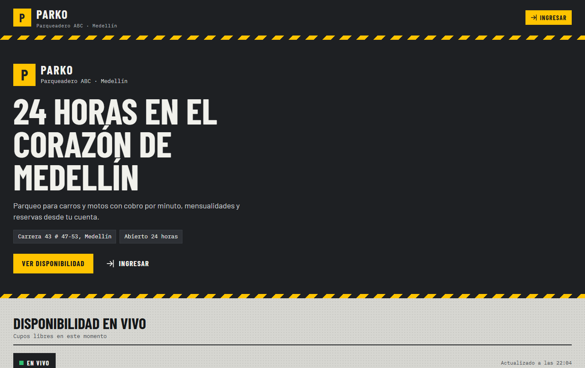
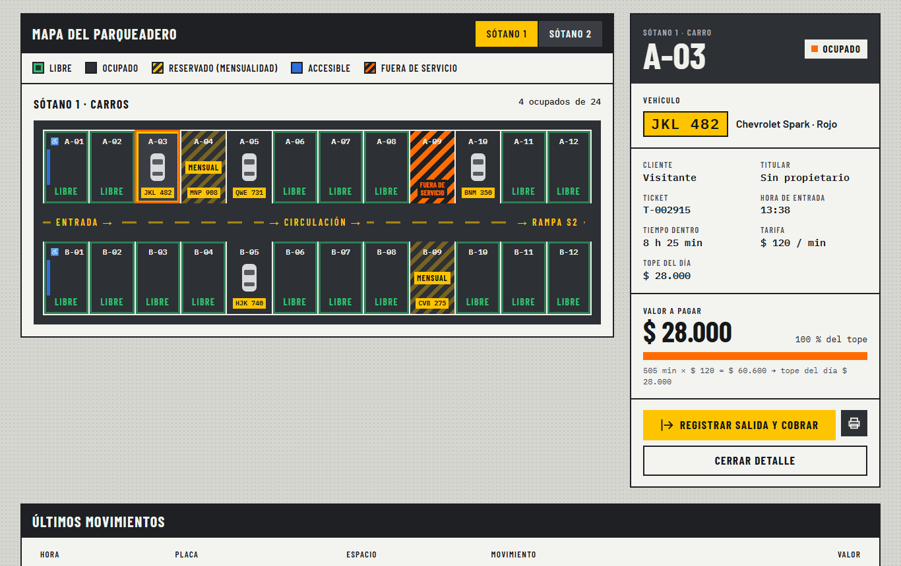
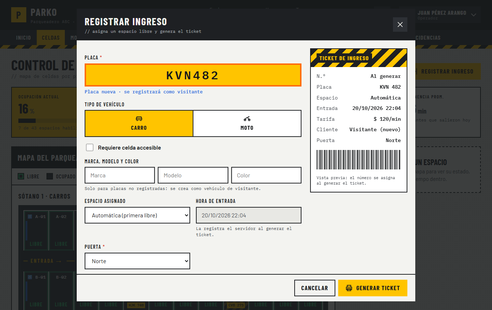
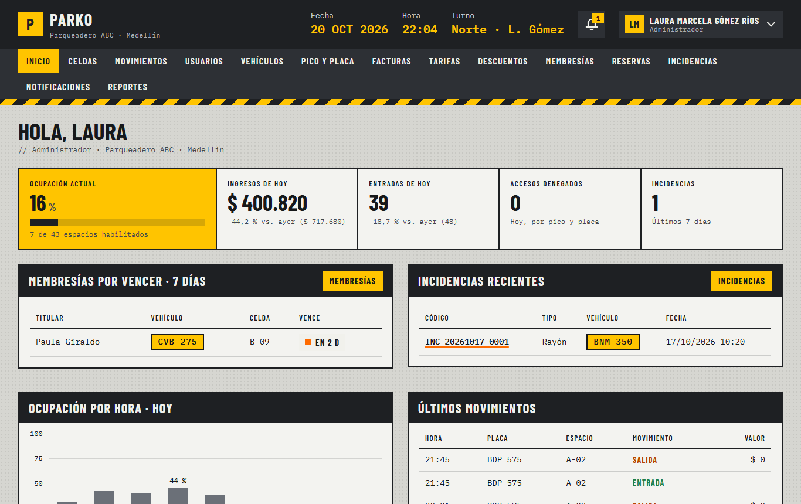
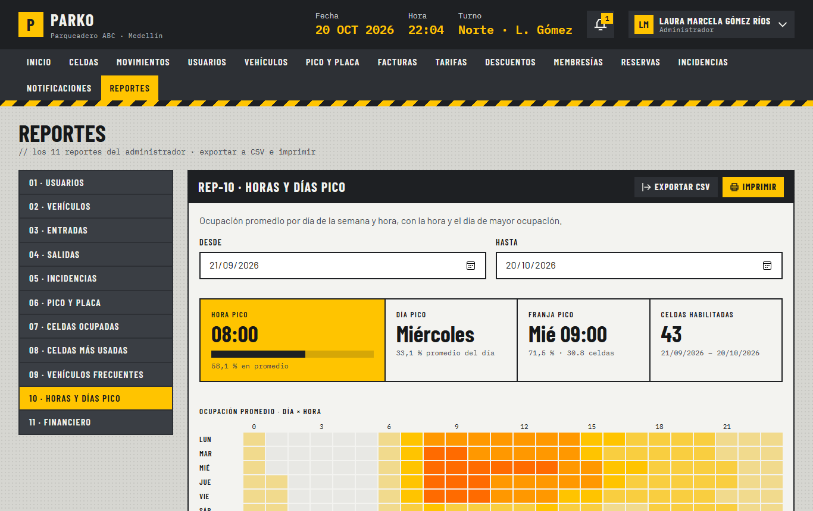
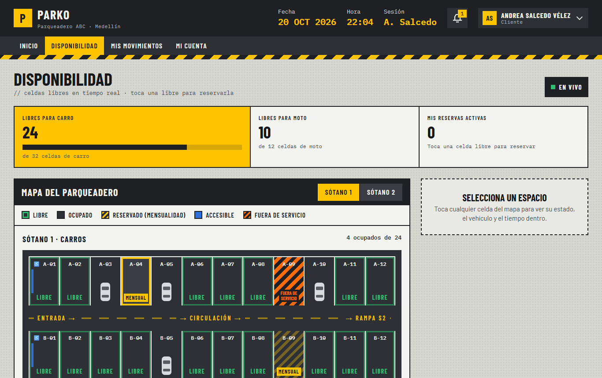
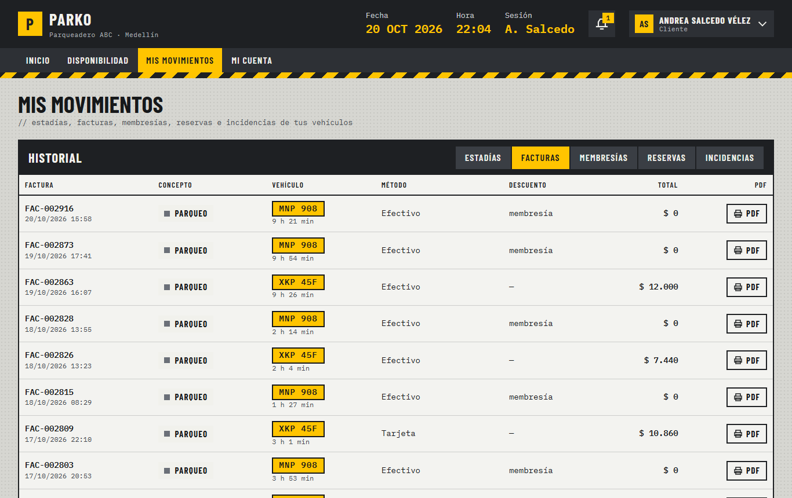
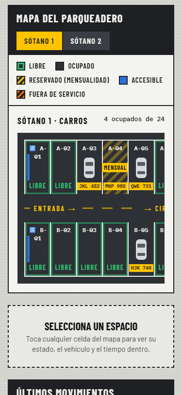

# PARKO · Sistema de gestión del Parqueadero ABC

**PARKO** es la aplicación web que reemplaza la operación manual del **Parqueadero ABC** (Carrera 43 # 47-53, Medellín; carros y motos; 24 horas). Cubre entradas y salidas por puerta, mapa de celdas en tiempo real, pico y placa, cobro por minuto con tope diario, facturas en PDF, membresías, reservas, incidencias, notificaciones internas y 11 reportes. Incluye un **portal para clientes** y una **página pública** con la disponibilidad en vivo.

- **Backend:** Node.js + Express 5 + MySQL 8 (`mysql2/promise`, SQL plano parametrizado, sin ORM), validación con zod, JWT en cookie httpOnly, SSE para tiempo real, PDFKit para tickets y facturas.
- **Frontend:** HTML + CSS + JavaScript vanilla (ES modules, sin frameworks ni bundler), **Atomic Design** y el sistema de diseño **PARKO** ("plano industrial", [`docs/diseno-parko/`](docs/diseno-parko/)). Express lo sirve como estático.

| Documento | Contenido |
|---|---|
| [`docs/manual-usuario.md`](docs/manual-usuario.md) | Guía por rol: administrador, operador y cliente |
| [`docs/api.md`](docs/api.md) | Los 109 endpoints con permiso, parámetros y ejemplos reales |
| [`docs/modelo-datos.md`](docs/modelo-datos.md) | Tablas y diagrama entidad-relación (Mermaid) |
| [`docs/trazabilidad.md`](docs/trazabilidad.md) | Cada requerimiento → endpoints → pantallas → pruebas → estado |
| [`docs/verificacion-manual.md`](docs/verificacion-manual.md) | Lista de verificación de cada pantalla con los 3 roles (escritorio y 375 px) |
| [`docs/requerimientos.md`](docs/requerimientos.md) · [`CLAUDE.md`](CLAUDE.md) | Requerimientos y reglas del proyecto |

## Capturas

| | |
|---|---|
|  **Página pública** con cupos en vivo, tarifas y pico y placa de hoy |  **Control de espacios** (operador): mapa en vivo, KPIs y detalle con el cobro |
|  **Registrar ingreso** con el ticket en vivo |  **Inicio del administrador** |
|  **Reportes** (11, con CSV e impresión) |  **Portal del cliente**: disponibilidad y reservas |
|  **Mis movimientos** del cliente |  **Móvil (375 px)**: menú desplegable y mapa con scroll propio |

## Requisitos

| Programa | Versión | Nota |
|---|---|---|
| **Node.js** | 20 LTS o superior (probado con 24) | Incluye `npm` |
| **MySQL Server** | **8.0** (probado con 8.0.46) | El esquema usa la collation `utf8mb4_0900_ai_ci`, que solo existe en MySQL 8 |
| Git | cualquiera | Para clonar el repositorio |
| Navegador | Chrome, Edge o Firefox actuales | |

> **¿XAMPP?** XAMPP instala **MariaDB**, no MySQL 8, y la base de datos de PARKO **no carga en MariaDB** (no tiene la collation `utf8mb4_0900_ai_ci`). Si ya usas XAMPP, detén su MySQL/MariaDB desde el panel de control (para liberar el puerto 3306) e instala MySQL Server 8 como se explica abajo, o cámbiale el puerto y usa ese en `DB_PORT`.

## Instalación paso a paso (Windows)

### 1. Instalar MySQL Server 8

1. Descarga **MySQL Installer for Windows** desde <https://dev.mysql.com/downloads/installer/> y elige la opción *Server only* (o *Developer Default* si también quieres MySQL Workbench).
2. En *Type and Networking* deja el puerto **3306**.
3. En *Accounts and Roles* define la contraseña del usuario **root** y anótala.
4. En *Windows Service* deja marcado que MySQL arranque como servicio.
5. Comprueba que funciona: abre *MySQL 8.0 Command Line Client*, escribe la contraseña y luego `SELECT VERSION();` (debe empezar por `8.0`).

### 2. Instalar Node.js

Descarga la versión **LTS** desde <https://nodejs.org/> e instálala con las opciones por defecto. En una terminal nueva (PowerShell o CMD) comprueba con `node -v` y `npm -v`.

### 3. Descargar el proyecto e instalar dependencias

```bash
git clone <url-del-repositorio> parko
cd parko/backend
npm install
```

### 4. Configurar las variables de entorno

```bash
copy .env.example .env
```

Genera la clave de las sesiones y pégala en `JWT_SECRET`:

```bash
node -e "console.log(require('crypto').randomBytes(48).toString('hex'))"
```

Abre `backend/.env` y completa:

| Variable | Descripción | Ejemplo |
|---|---|---|
| `PORT` | Puerto HTTP (API + frontend) | `3000` |
| `NODE_ENV` | `development` (muestra detalle de errores), `test` o `production` | `development` |
| `TZ` | Zona horaria del proceso (**no cambiar**) | `America/Bogota` |
| `DB_HOST` / `DB_PORT` | Servidor MySQL | `127.0.0.1` / `3306` |
| `DB_USER` / `DB_PASSWORD` | Usuario de MySQL con permiso para crear bases de datos | `root` / *(la clave del paso 1)* |
| `DB_NAME` | Nombre de la base de datos (solo letras, números y `_`) | `parking_lot_abc` |
| `JWT_SECRET` | Cadena aleatoria de 32+ caracteres que firma las sesiones | *(la generada arriba)* |
| `JWT_EXPIRES_IN` | Duración de la sesión | `8h` |
| `TRUST_PROXY` | Proxies inversos delante de Express (0 = ninguno; 1 detrás de un proxy HTTPS) | `0` |

### 5. Crear la base de datos con los datos de prueba

```bash
npm run db:reset
```

Crea la base de datos `DB_NAME` (si existe, **la borra**), carga [`database/schema.sql`](backend/database/schema.sql) y una semilla recién generada. Al terminar muestra un conteo como `Datos cargados: { usuarios: 9, celdas: 44, … }`.

### 6. Arrancar

```bash
npm run dev          # con recarga automática (nodemon)
npm start            # sin recarga
```

Abre <http://localhost:3000> y entra con uno de los usuarios de prueba.

**Problemas frecuentes**

| Síntoma | Causa y solución |
|---|---|
| `ECONNREFUSED 127.0.0.1:3306` | MySQL no está corriendo: inicia el servicio *MySQL80* (Servicios de Windows) |
| `Access denied for user 'root'` | `DB_PASSWORD` no coincide con la clave de root |
| `Unknown collation: 'utf8mb4_0900_ai_ci'` | Estás conectado a MariaDB (XAMPP), no a MySQL 8 |
| `JWT_SECRET debe tener al menos 32 caracteres` | Falta generar la clave del paso 4 |
| `EADDRINUSE :::3000` | Otro programa usa el puerto: cambia `PORT` |

## Usuarios de prueba

Todos entran con **tipo de documento + número + contraseña**.

| Rol | Tipo | Documento | Contraseña | Nombre | Observación |
|---|---|---|---|---|---|
| Administrador | CC | `<1000000001>` | `Admin2026*` | Laura Gómez | |
| Operador | CC | `1000000002` | `Operador2026*` | Juan Pérez | |
| Operador | CC | `1000000003` | `Operador2026*` | Sebastián Duque | |
| Cliente | CC | `1000000004` | `Cliente2026*` | Andrea Salcedo | Mensualidad con celda fija A-04 |
| Cliente | CC | `1000000005` | `Cliente2026*` | Paula Giraldo | Mensualidad con celda fija B-09 (vence en 2 días) |
| Cliente | CC | `1000000006` | `Cliente2026*` | Hernán Quintero | Mensualidad sin celda fija |
| Cliente | CE | `1000000007` | `Cliente2026*` | Lucía Ortega | |
| Cliente | CC | `1000000008` | `Cliente2026*` | Camilo Restrepo | **Debe cambiar la contraseña** al entrar |
| Cliente | CC | `1000000009` | `Cliente2026*` | Felipe Mora | **Inactivo**: no puede iniciar sesión |

La semilla trae además la sede con 2 puertas (Norte y Sur), 2 sótanos con **44 celdas** (la distribución de la maqueta; A-01/B-01 accesibles, A-09 fuera de servicio), 122 vehículos, 3 mensualidades, 7 vehículos dentro, **~2.900 estadías y facturas de los últimos 60 días** (con horas pico y fines de semana más tranquilos), ~85 rechazos por pico y placa, 10 incidencias, tarifas (carro $ 120/min con tope de $ 28.000 por día; moto $ 60/min con tope de $ 12.000), 3 descuentos y los parámetros del negocio. Las fechas son relativas al día en que se ejecuta `db:reset`.

## Scripts (`backend/`)

| Comando | Qué hace |
|---|---|
| `npm run dev` / `npm start` | Arranca el servidor en `PORT` |
| `npm run db:reset` | **Borra** y recrea la BD: genera `seed.sql` y carga `schema.sql` + `seed.sql` (bloqueado con `NODE_ENV=production`) |
| `npm run db:seed:generar` | Solo regenera `database/seed.sql` |
| `npm test` | Pruebas Jest + supertest |
| `npm run test:cobertura` | Pruebas + cobertura de los services (umbral 80 % en sentencias, ramas, funciones y líneas; informe HTML en `backend/coverage/`) |
| `npm run lint` | ESLint sobre `backend/` y `frontend/js/` |
| `npm run format` | Prettier |

## Pruebas

```bash
cd backend
npm run db:reset     # las pruebas usan la BD de .env con la semilla cargada
npm test
```

- **14 suites y 234 pruebas**: login y sesión, permisos por rol (401/403), usuarios y vehículos, celdas y SSE, pico y placa, entradas y salidas, cálculo del cobro (gracia, fracción exacta, más de 24 h, membresía, descuento, redondeo), facturas y membresías, incidencias y notificaciones, los 11 reportes y su CSV, reservas y su vencimiento, endpoints públicos sin datos personales, manejo de errores y el **flujo completo** de un cliente nuevo hasta los reportes, con **concurrencia** (dos operadores en la misma celda, dos pagos de la misma estadía, dos reservas de la misma celda).
- Cobertura de los services: **≥ 80 %** en las cuatro métricas (`npm run test:cobertura` falla si baja).
- Cada suite deja la base de datos como la encontró. Si una prueba se interrumpe a mitad, `npm run db:reset` la restaura.
- La prueba manual guiada por pantalla y rol está en [`docs/verificacion-manual.md`](docs/verificacion-manual.md).

## Base de datos

- [`backend/database/schema.sql`](backend/database/schema.sql): modelo consolidado, **con todas las migraciones aplicadas**. Una instalación nueva solo necesita `schema.sql` + `seed.sql`. Descripción y diagrama en [`docs/modelo-datos.md`](docs/modelo-datos.md).
- [`backend/database/migrations/`](backend/database/migrations/): solo para actualizar una BD creada en fases anteriores, aplicando en orden los archivos posteriores a su fase (`001`… `005`; la `005` agrega la ubicación de la sede).
- Los valores del negocio (minutos de reserva, valores de membresía, días de aviso, redondeo, pie del ticket) están en la tabla `configuracion` y el administrador los edita en **Tarifas → Parámetros del negocio**. La ubicación del mapa público sale de `parqueaderos.latitud` / `longitud`.

## Seguridad

- Contraseñas con **bcrypt** (cost 10); nunca se devuelve `contrasena_hash`. La contraseña temporal obliga a cambiarla en el primer acceso.
- Sesión: JWT en cookie `httpOnly`, `SameSite=Strict`, `Secure` en producción, 8 h. Los usuarios inactivos pierden la sesión al instante.
- Rate limit: login 5 intentos fallidos / 15 min por IP + documento; API 300 solicitudes/min por IP.
- `helmet` con CSP propia (scripts solo del mismo origen; fuentes de Google; iframe solo de OpenStreetMap).
- Consultas siempre parametrizadas; `ORDER BY` solo desde listas blancas; `LIKE` con comodines escapados.
- Validación zod en **todas** las rutas y `requirePermiso` en cada acción ([tabla en `docs/api.md`](docs/api.md#endpoints-109)). Los recursos ajenos (facturas, reservas, usuarios, notificaciones) responden 403/404.
- Fotos: solo JPG/PNG verificados por su firma real, ≤ 2 MB, nombre aleatorio; `/uploads` exige sesión y las fotos de lectura de placa solo las ve el personal.
- Errores 500 sin stack fuera de desarrollo; las páginas muestran la página de error de PARKO.
- Frontend sin `innerHTML` con datos (ESLint lo bloquea); todo el texto pasa por `textContent`.

## Estructura

```
/
├── CLAUDE.md                 contexto permanente del proyecto
├── docs/                     requerimientos, manual, API, modelo de datos, trazabilidad,
│                             verificación manual, capturas, diseño PARKO, wireframes
├── backend/
│   ├── src/
│   │   ├── app.js            Express: helmet (CSP), json, cookies, rate limit, /api/v1, estáticos, errores
│   │   ├── server.js         arranque, tareas programadas y apagado ordenado
│   │   ├── config/           env (validado con zod), pool MySQL, constantes
│   │   ├── middlewares/      auth, require-permiso, validate, rate-limit, upload, error-handler
│   │   ├── modules/          un folder por módulo: routes → controller → service → repository (+ schemas)
│   │   │                     auth, salud, parqueadero, roles, usuarios, vehiculos, pisos, celdas,
│   │   │                     puertas, publico, pico-placa, estadias, tarifas, descuentos, membresias,
│   │   │                     facturas, notificaciones, incidencias, reportes, reservas, dashboard,
│   │   │                     configuracion
│   │   ├── jobs/             membresías (cada hora) y reservas (cada minuto)
│   │   ├── utils/            errores, paginación, placas, archivos, fechas (Bogotá), dinero, sql, csv, pdf
│   │   └── realtime/         emisor, helper SSE y publicación de cambios de celdas
│   ├── database/             schema.sql, seed.sql, generar-seed.js, reset.js, migrations/
│   ├── tests/                Jest + supertest (14 suites)
│   └── uploads/              fotos (ignorado por git)
└── frontend/
    ├── index.html · login.html · 404.html · error.html
    ├── app/                  una página por pantalla, con TODO su marcado escrito en HTML
    ├── assets/               icons.svg (sprite), favicon.svg
    ├── styles/
    │   ├── atomic.css        hoja principal: importa tokens, base y los cuatro niveles
    │   ├── tokens.css · base.css
    │   └── atomic/           atoms.css · molecules.css · organisms.css · templates.css
    └── js/
        ├── pages/            un controlador por página: solo eventos del DOM y texto
        │   └── comun/        marco (header, menú, campana), modales, tablas, mapa, gráficos…
        ├── services/         api.js (fetch) + un servicio por módulo
        └── utils/            formato (COP, fechas Bogotá), placa, sesión/rol, navegación, almacén
```

### Frontend: HTML + CSS con Atomic Design, JS solo para eventos

- **El HTML de cada pantalla está escrito completo** en su archivo `.html` (encabezado, menú, paneles, formularios, modales). El JavaScript **no crea componentes**: maneja eventos (clics, teclado, envíos), llama a la API y rellena textos con `textContent`, y muestra u oculta partes con la clase `hidden`.
- Lo que se repite según los datos de la BD (celdas del mapa, filas de tablas, opciones, notificaciones) está escrito una vez en una etiqueta `<template>` de la página; el JS la copia (`cloneNode`) y le pone el texto.
- **Clases con el nivel de Atomic Design como prefijo:** `atom-button`, `atom-plate`, `molecule-field`, `molecule-space`, `organism-navbar`, `organism-parking-map-lane`, `template-app-layout-page`… Modificadores con `--` (`atom-button--dark`) y estados con `is-` (`is-active`, `is-selected`). Los valores visuales son los de `docs/diseno-parko/styles.css`, sin cambios.
- `/app/_catalogo.html` (solo desarrollo) muestra un ejemplo de cada clase.

## Pantallas

| URL | Pantalla | Roles |
|---|---|---|
| `/` | Página pública: cupos en vivo, tarifas y mensualidades, servicios, pico y placa de hoy, ubicación | Todos, sin sesión |
| `/login.html` · `/app/cambiar-contrasena.html` | Inicio de sesión · cambio de contraseña | Todos |
| `/app/inicio.html` | Dashboard según el rol | Todos |
| `/app/celdas.html` | Control de espacios: mapa en vivo, registrar ingreso, salida y cobro, gestión de celdas y de **puertas** (admin) | Admin, operador (cliente: solo lectura) |
| `/app/historial.html` | Movimientos con filtros, PDF del ticket y CSV | Admin, operador |
| `/app/usuarios.html` · `/app/vehiculos.html` | Usuarios (el admin edita, activa/inactiva y restablece contraseñas) · vehículos y propietarios | Admin, operador (según permiso) |
| `/app/pico-placa.html` | Reglas de pico y placa | Admin, operador |
| `/app/facturacion.html` · `/app/tarifas.html` · `/app/descuentos.html` · `/app/membresias.html` | Cobro y configuración (Tarifas incluye los **parámetros del negocio** para el admin) | Admin (operador: consulta) |
| `/app/reservas.html` · `/app/incidencias.html` | Reservas (listado, cancelación y **nueva reserva** para un cliente) · incidencias | Admin, operador |
| `/app/notificaciones.html` | Bandeja y envío de mensajes (envío solo admin) | Todos |
| `/app/reportes.html` | 11 reportes con CSV e impresión | Admin |
| `/app/disponibilidad.html` · `/app/mis-movimientos.html` | Portal del cliente: mapa y reservas · estadías, facturas, membresías, reservas e incidencias | Cliente |
| `/app/mi-cuenta.html` | Mis datos, contraseña, mis vehículos y notificaciones | Todos |

Si un rol abre por URL una pantalla que no le corresponde, ve "Sin acceso" y la página no carga datos.

## Despliegue en producción

1. En el servidor: Node.js LTS y MySQL 8; dentro de `backend/`, `npm ci --omit=dev`.
2. Crea la BD **una sola vez** con `schema.sql` y los datos que correspondan. No uses `npm run db:reset`: borra todo y está bloqueado con `NODE_ENV=production`. Para empezar sin datos de prueba, carga de `seed.sql` solo las secciones de roles, permisos, sede, pisos, puertas, celdas, tarifas, pico y placa, tipos de incidencia y configuración, y crea el primer administrador.
3. En `.env`: `NODE_ENV=production`, un `JWT_SECRET` nuevo y un usuario de MySQL **propio** (no `root`) con permisos solo sobre esa base.
4. Pon delante un proxy con **HTTPS** (Nginx, IIS con ARR o Caddy): en producción la cookie de sesión es `Secure` y no viaja por HTTP. Detrás del proxy usa `TRUST_PROXY=1`.
5. Mantén el proceso vivo con un gestor de servicios (por ejemplo `pm2 start src/server.js --name parko`, o un servicio de Windows con NSSM). El servidor se apaga ordenadamente con SIGINT/SIGTERM.
6. Respaldos diarios: `mysqldump --single-transaction parking_lot_abc > respaldo.sql` y una copia de `backend/uploads/` (fotos).
7. Monitoreo: `GET /api/v1/salud` responde `{ "estado": "ok", "bd": "ok" }` (503 si la BD no responde).

## Fuera de alcance (decisión del cliente)

Reconocimiento real de placas (OCR), facturación electrónica DIAN, pasarela de pagos y envío de correos o SMS. La lectura de placa, el pago y la factura son **simulados** dentro del sistema (placa digitada + foto opcional, método de pago registrado, PDF interno).
