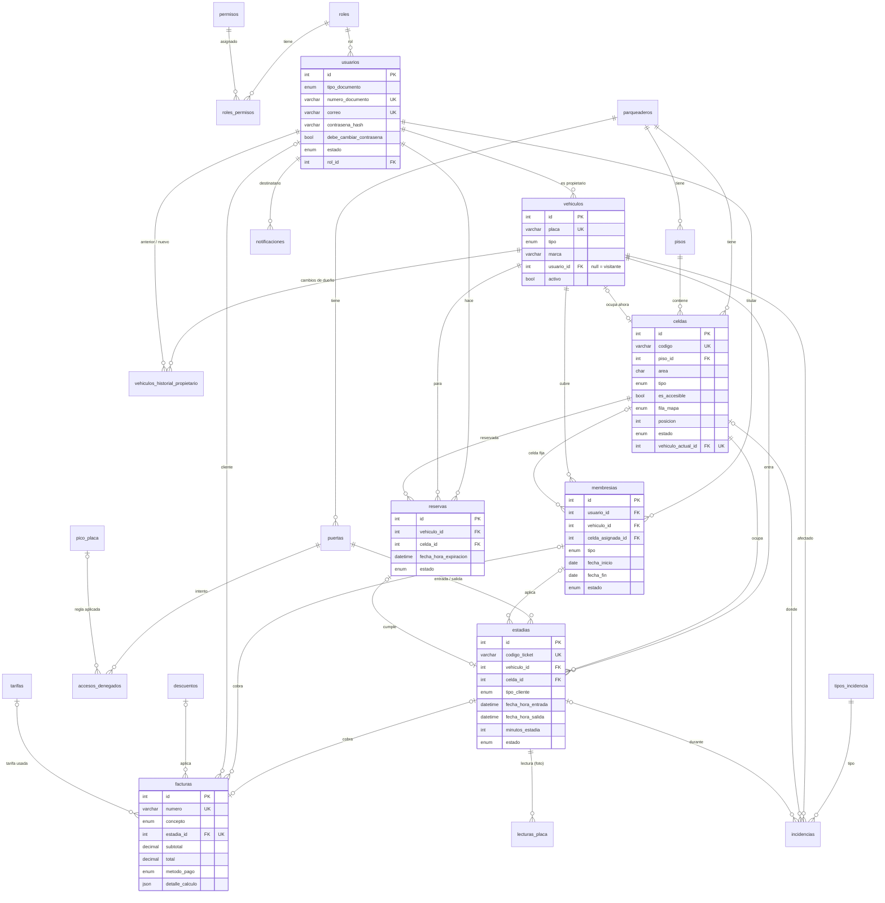

# PARKO · Modelo de datos

Base de datos **MySQL 8** (InnoDB, `utf8mb4`). La fuente de verdad es [`backend/database/schema.sql`](../backend/database/schema.sql): ya incluye todas las migraciones (`001`…`005`, fases 1–8), así que una instalación nueva solo necesita `schema.sql` + `seed.sql` (o `npm run db:reset`). La carpeta `migrations/` queda únicamente para actualizar bases creadas antes de cada fase.

Une y corrige los dos borradores de `docs/bd-referencia/` (sin claves primarias compuestas innecesarias, historiales que sí permiten repetir vehículo y celda, campos faltantes).

## Reglas generales

- PK `id INT AUTO_INCREMENT` (salvo `roles_permisos`, `consecutivos` y `configuracion`, con clave natural).
- Todas las FK con `ON DELETE RESTRICT`: nunca se borra un registro con historial.
- **Borrado lógico** en usuarios (`estado`), vehículos, celdas, tarifas, descuentos, puertas y tipos de incidencia (`activo`/`activa`).
- `created_at` / `updated_at` en las tablas de negocio.
- Dinero en `DECIMAL(12,2)` (pesos colombianos). Placas en MAYÚSCULAS sin espacios. Horas en zona **America/Bogotá**, puestas por el servidor.
- Valores enumerados como `ENUM` (tipo de vehículo, estados, método de pago…).
- **Unicidad condicional con columnas generadas**: `estadias.vehiculo_estadia_abierta` / `celda_estadia_abierta` y `reservas.vehiculo_reserva_activa` / `celda_reserva_activa` solo tienen valor mientras la estadía está abierta o la reserva activa; un índice `UNIQUE` sobre ellas impide en la propia BD dos estadías abiertas del mismo vehículo o en la misma celda, y dos reservas activas del mismo vehículo o de la misma celda, incluso con operadores simultáneos.

## Diagrama entidad-relación

## Tablas

### Seguridad y usuarios

| Tabla | Para qué | Campos clave y reglas |
|---|---|---|
| `roles` | Los 3 perfiles iniciales (REQ-USR-1): `administrador`, `operador`, `usuario` | `nombre` único |
| `permisos` | Acciones del sistema con código `modulo.accion` (ej. `usuarios.crear`) | `codigo` único; el middleware `requirePermiso` los verifica |
| `roles_permisos` | Qué permisos tiene cada rol | PK (`rol_id`, `permiso_id`) |
| `usuarios` | Administradores, operadores y clientes (REQ-USR-2) | `tipo_documento` (CC, CE, TI, PAS, NIT) + `numero_documento` únicos; `correo` único; `contrasena_hash` (bcrypt, nunca sale por la API); `debe_cambiar_contrasena` (contraseña temporal); `estado` activo/inactivo (un inactivo no inicia sesión); `creado_por`; `ultimo_acceso` |
| `notificaciones` | Campana interna (REQ-NOT-1) | `usuario_id` destinatario; `tipo` (perfil_actualizado, incidencia, pico_placa, membresia_por_vencer, reserva_expirada, manual…); `enlace`; `leida` / `leida_at`; `enviada_por` (mensajes manuales del admin) |

### Sede, mapa y vehículos

| Tabla | Para qué | Campos clave y reglas |
|---|---|---|
| `parqueaderos` | Sede (Parqueadero ABC, Medellín) | `nombre` + `ciudad` forman el subtítulo de la marca; `direccion`, `telefono`, `horario`; `latitud` / `longitud` para el mapa de la página pública |
| `pisos` | Niveles del mapa | `nombre` único por sede, `orden`, `texto_carril` ("ENTRADA → · CIRCULACIÓN → · RAMPA S2") |
| `puertas` | Accesos (REQ-INEX-1/2) | `tipo` entrada / salida / mixta; `activa`; siempre queda al menos una activa |
| `celdas` | Espacios de parqueo (REQ-CLD-01..03) | `codigo` único (A-01, M-12); `area`; `tipo` moto/carro; `es_accesible`; `fila_mapa` superior/inferior + `posicion` (únicos por piso) para dibujar el mapa; `estado` disponible / ocupada / reservada / fuera_servicio; `vehiculo_actual_id` (único: un vehículo, una celda); `nota` (motivo de fuera de servicio); `activa` |
| `vehiculos` | Carros y motos (REQ-CAR-1) | `placa` única (carro `ABC123`, moto `ABC12` o `ABC12D`); `tipo`; marca, modelo, color; `usuario_id` (sin dueño = visitante); `activo` |
| `vehiculos_historial_propietario` | Cada asignación o cambio de dueño (REQ-USR-6, REQ-CAR-3) | `usuario_anterior_id`, `usuario_nuevo_id`, `cambiado_por`, `fecha`, `motivo` |

### Operación

| Tabla | Para qué | Campos clave y reglas |
|---|---|---|
| `pico_placa` | Restricciones (REQ-CAR-4) | (`tipo_vehiculo`, `dia_semana` 1–7, `digito` 0–9, `hora_inicio`, `hora_fin`, `activa`). Carros: último dígito; motos: primer dígito numérico. Sin traslapes |
| `estadias` | Entrada + salida + tiempo en una sola fila (REQ-INEX-1..3); reemplaza `ACCESO_SALIDAS`, `ingresos_salidas` e `HISTORIAL_PARQUEO` | `codigo_ticket` único (`T-000123`, REQ-TCK-1); `tipo_cliente` visitante/mensualidad (lo detecta el sistema); `membresia_id`, `reserva_id`; puertas de entrada y salida; fechas del servidor; `minutos_estadia`; `requiere_accesible`, `observaciones_entrada`, `deja_llaves`; `estado` en_curso/finalizada; quién registró cada lado |
| `accesos_denegados` | Entradas rechazadas por pico y placa (REQ-INEX-4) | `placa`, `tipo_vehiculo`, `puerta_id`, `fecha_hora`, `motivo`, `regla_pico_placa_id`, `registrado_por` |
| `lecturas_placa` | "Lectura de placa" simulada (REQ-PLA-1) | `placa_leida`, `imagen_url` (foto opcional jpg/png ≤ 2 MB), `puerta_id`, `estadia_id` |
| `reservas` | Reservas del cliente (REQ-RES-1) | `estado` pendiente / confirmada / cumplida / cancelada / expirada; `fecha_hora_expiracion` (= reserva + `reserva_minutos_expiracion`); máximo una activa por vehículo y por celda |
| `tipos_incidencia` | Catálogo: Rayón, Choque, Atropellamiento, Golpe contra muro | `nombre` único; `activo` |
| `incidencias` | Novedades (REQ-INCD-1) | `codigo` único `INC-AAAAMMDD-0001`; `tipo_incidencia_id`, `vehiculo_id`, `celda_id` y `estadia_id` opcionales; `fecha_hora` del servidor; `registrada_por` |

### Cobro

| Tabla | Para qué | Campos clave y reglas |
|---|---|---|
| `tarifas` | Tarifa por tipo de vehículo (REQ-TAR-1) | `valor_fraccion`, `minutos_fraccion`, `minutos_gracia`, `valor_dia_maximo` (tope por cada 24 h), `vigente_desde`, `activa` (una vigente por tipo; las anteriores quedan como historial) |
| `descuentos` | Descuentos al facturar (REQ-DES-1) | `nombre` único, `descripcion`, `porcentaje` 0–100, `activo` |
| `membresias` | Mensualidades y anualidades (REQ-MEM-1) | `usuario_id` + `vehiculo_id`; `tipo` mensual/anual; `valor` (de `configuracion`); `fecha_inicio`, `fecha_fin` calculada; `estado` activa/vencida/cancelada; `celda_asignada_id` opcional (celda fija, queda `reservada` mientras el vehículo está fuera) |
| `facturas` | Recibos (REQ-FAC-1/2) | `numero` consecutivo `FAC-000001` sin huecos; `concepto` estadia/membresia; `estadia_id` único (una factura por estadía); `cliente_id`; `subtotal`, `descuento_id`, `porcentaje_descuento`, `valor_descuento`, `total`; `metodo_pago` efectivo/tarjeta/transferencia (simulado); `observacion` ("membresía" cuando sale en $0); `tarifa_id` y `detalle_calculo` (JSON) para que el PDF no cambie si luego cambia la tarifa; `fecha_pago` del servidor |
| `consecutivos` | Numeración segura ante pagos simultáneos | Fila `factura` y una fila `incidencia-AAAAMMDD` por día; se bloquea con `FOR UPDATE` dentro de la transacción |

### Parámetros

`configuracion` (clave / valor / tipo) guarda los valores de negocio editables, para que no queden en el código:

| Clave | Semilla | Uso |
|---|---|---|
| `reserva_minutos_expiracion` | 30 | Minutos que dura una reserva si el vehículo no llega |
| `membresia_dias_aviso_vencimiento` | 3 | Días antes del vencimiento en que se avisa al cliente |
| `membresia_valor_mensual_carro` / `_anual_carro` | 180.000 / 1.900.000 | Valor de la membresía de carro |
| `membresia_valor_mensual_moto` / `_anual_moto` | 70.000 / 750.000 | Valor de la membresía de moto |
| `facturacion_redondeo` | 100 | Redondeo del total con descuento (a la centena) |
| `ticket_mensaje_pie` | "Conserve este ticket…" | Texto al pie del ticket |

## Transacciones que protegen la consistencia

| Operación | Qué bloquea | Qué garantiza |
|---|---|---|
| Entrada (`POST /estadias/entrada`) | La celda (`SELECT … FOR UPDATE`) + índices únicos de estadía abierta | Dos operadores no ocupan la misma celda; un vehículo no queda dos veces dentro; la reserva pasa a `cumplida` en la misma transacción |
| Pago (`POST /estadias/:id/pagar`) | La estadía + el consecutivo de facturas | Una sola factura por estadía, números sin repetir ni saltar; la celda se libera y la estadía se cierra en la misma transacción |
| Reserva (`POST /reservas`) | La celda + índices únicos de reserva activa | Dos clientes no reservan la misma celda; un vehículo no tiene dos reservas activas |
| Vencimiento de reservas y membresías (tareas programadas) | Cada reserva/membresía y su celda | La celda vuelve a `disponible` (o a `reservada` si es la celda fija de otra mensualidad) |

Las pruebas `tests/flujo-completo.test.js` y `tests/facturacion.test.js` verifican estos casos con peticiones simultáneas.
